# Scrivus

Scrivus is a local-first writing app for drafting, organizing, planning, and compiling long-form fiction projects. Keep manuscripts, notes, lore, a planning board, and maps together in one project folder, with separate local backups and no cloud account required.

Projects are stored as `.scrivus` folders on your computer. Your writing stays local, and Scrivus keeps project data in readable project files alongside scene documents and managed assets.


## Features

- Draft manuscripts in a focused rich-text editor with draft tabs, scene navigation, focus mode, typewriter scrolling, formatting controls, writing goals, writing sprints, and optional lore-link highlights.
- Compare drafts in a horizontal split-view reference pane while editing another draft version, or open a dedicated draft comparison view with word-level change highlights.
- Review scenes in the read-only Revise workspace with anchored comments, per-draft review tabs, and All, Open, and Resolved comment filters. Share review packages and bring reviewer feedback back into the original project.
- Organize chapters, scenes, notes, and folders in a binder with drag-and-drop, multi-select actions, trash, restore, and duplicate tools.
- Track scene metadata including status, POV, location, timeline, tags, and synopsis.
- Keep multiple manuscripts in one project, each with its own book metadata, cover, and compile selections, while sharing worldbuilding and planning tools.
- Review manuscript structure in Outline with configurable metadata columns, expandable synopses, scene-length bars, chapter and act progress summaries, and a collapsible pacing strip.
- Plan visually with Canvas, a freeform board for titled ideas, scenes, characters, locations, notes, color labels, and connections.
- Build a searchable Lore Book with custom categories, nested subcategories, reusable templates, lists, images, cropped entry icons, pinned entries, scene mentions, and a chapter-by-chapter presence chart. Preview matching Lore entries directly in the writing inspector.
- Manage maps in Atlas with imported map images, multiple maps, zooming, panning, marker search, marker categories, visibility toggles, and Lore Book-linked markers.
- Compile selected manuscript content to `.docx` or `.epub`, with remembered act, chapter, scene, and draft-tab selections, cover image support, and standard, proof copy, and Shunn manuscript presets.
- Import a `.docx` manuscript into a new Scrivus project, splitting Act, Chapter, and Scene headings into manuscript structure.
- Navigate large Canvas boards and Atlas maps with interactive minimaps, zoom controls, and fit-to-content actions.
- Use categorized project variables and expressions with autocomplete in the editor, and share worldbuilding between projects through World packages.
- Keep local project backups with configurable locations and retention, manual backup, and restore flows.
- Use global themes, recent projects, project compatibility checks, recovery options, and update checks from GitHub Releases.

## Getting Around

Use the top navigation to switch between **Write**, **Revise**, **Outline**, **Lore**, **Canvas**, and **Atlas**. Press **Ctrl+K** or click **Jump to…** to find scenes, Lore entries, and workspaces.

The manuscript selector in the binder switches between manuscripts. Each manuscript has its own scene tree and export settings; Notes, Lore, Canvas, and Atlas remain shared across the project. Use **Edit > Project Settings** to manage book metadata, covers, variables, dictionaries, and backup preferences.

The binder supports scene, chapter, and act word counts, with a display preference under **Edit > Preferences**. Chapter and act progress rings summarize scene completion, and warning dots flag scenes marked Needs Work.

## Workspaces

### Write

Write is the main drafting surface. It pairs the binder, draft tabs, formatting toolbar, manuscript editor, inspector, spellcheck, writing goals, writing sprints, and optional Lore-link highlights.

The inspector has **Scene** and **Notes** tabs. Scene contains metadata and **In This Scene**, which detects Lore names and keywords in the current draft, counts mentions, and lets you expand entry details or open the full Lore entry. Notes holds the project's quick note and checklist.

Scene navigation buttons move through manuscript order without leaving the keyboard-heavy drafting flow. Focus mode hides the outer app chrome while keeping the draft tabs, editor toolbar, and status bar available. Typewriter scrolling can keep the caret line centered while you write, and the sprint timer tracks word progress for timed sessions. Scrivus also remembers the last opened scene and active draft tab when a project is reopened.

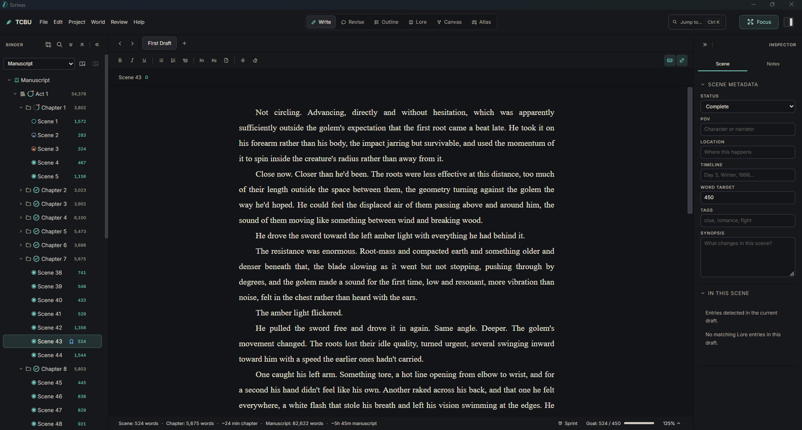

Scrivus also includes a focus mode for distraction free writing.

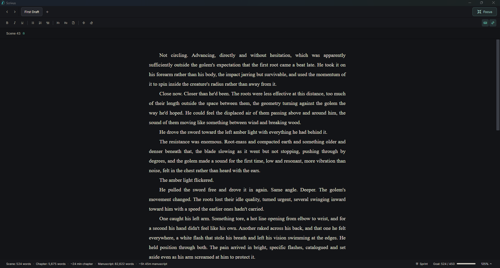

When a scene has multiple draft tabs, Write can open a read-only split-view reference pane. This lets you edit the active draft while viewing another draft below it, with comment highlights available as hover previews. The reference pane shares Revise's read-only edge glow, controlled by **Read-only Edge Glow** in Preferences > General.

Selected editor text can be linked to existing Lore Book entries or used to create a new Lore Book entry through the context menu. When lore links are enabled, matching entry names and keywords are highlighted in the manuscript.

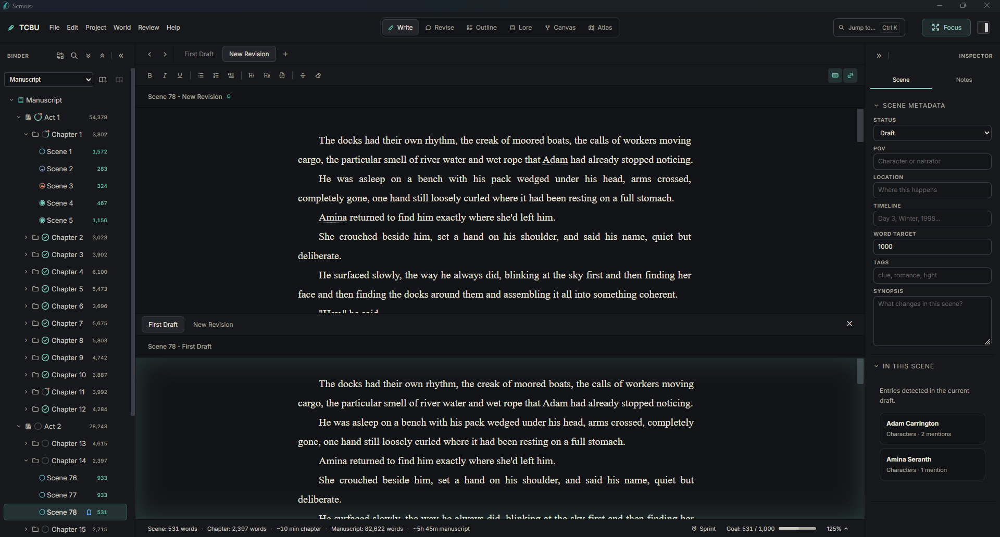

### Draft Difference

Draft Difference compares two draft tabs from the same scene so revisions can be reviewed before old text is discarded. Open it from a draft tab context menu, choose the two drafts to compare, then scan paragraph-level changes with word-level added and removed highlights.

The view counts inserted and deleted words, supports swapping the comparison direction, and focuses on text changes rather than formatting-only edits.

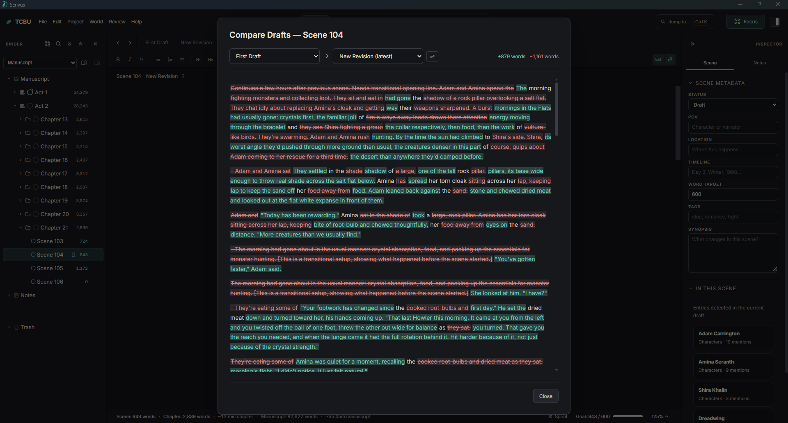

### Revise

Revise provides a dedicated read-only review workspace for scene-level feedback. Select a scene from the binder, switch between that scene's draft tabs, highlight text to add an anchored comment, then resolve, reopen, or delete comments from the comments pane.

Comments are scoped to the active scene and draft tab, so feedback for an earlier draft stays separate from notes on a later revision. Active comments are highlighted in the manuscript view, and unresolved comment counts appear on draft tabs. Use **All**, **Open**, or **Resolved** to filter comments. The comments pane can collapse when you want more room to read. A configurable edge glow distinguishes the read-only pane from the editable draft.

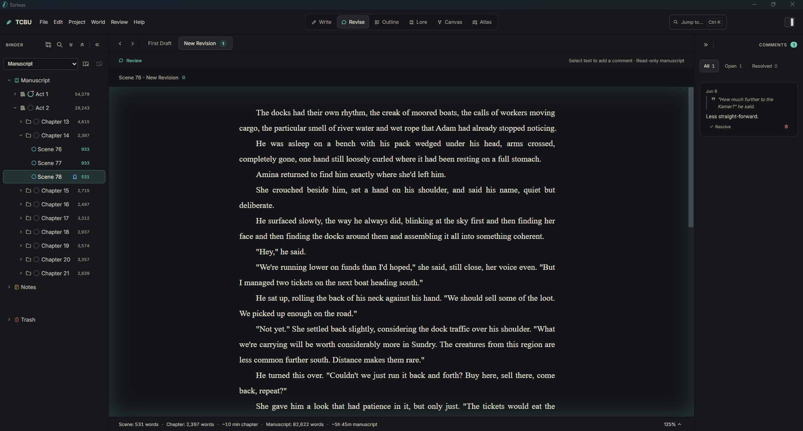

### Outline

Outline gives a manuscript-level view of acts, chapters, and scenes. Update scene status, compare scene-length bars, and expand a synopsis without opening its scene. The **Columns** menu controls comments, POV, location, timeline, and tags, and remembers your choices. Chapter and act progress summaries match the binder.

A collapsible pacing strip summarizes scene length and status across the manuscript, with bars grouped by chapter and a guide line for average scene length.

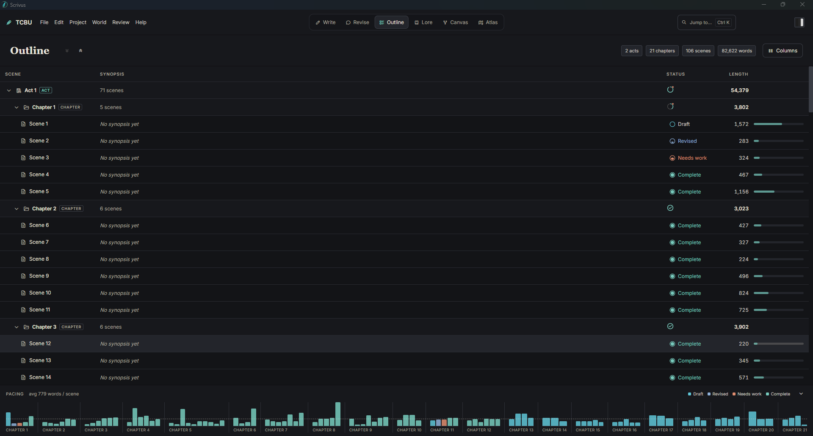

### Canvas

Canvas is a freeform planning board for story structure, relationships, and loose ideas. Nodes can represent ideas, scenes, characters, locations, and notes, with labeled connections between them.

Nodes support optional multiline titles, expanding note areas, color labels, a color legend, duplication, and quick scene creation. When a node creates a scene, Scrivus uses the node title before falling back to the node notes. Labeled connections attach to node sides. Use the interactive minimap, zoom controls, or **Fit all nodes** to navigate a large board.

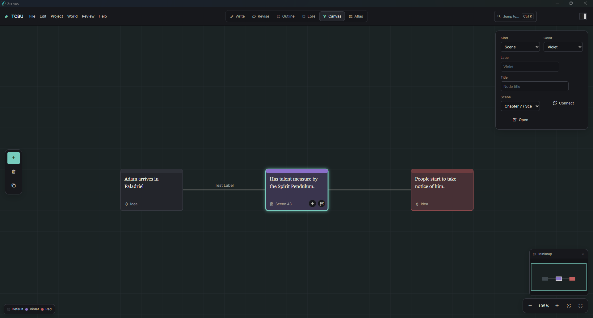

### Lore Book

Lore stores worldbuilding and reference material in customizable categories and nested subcategories. Templates support text, lists, images, headers, dividers, and other field types. Entry names and keywords connect that reference material to manuscript mentions.

Browse the category binder and grouped entry list, or search across all categories by name or keyword. Category expansion is remembered per project. Selected entries show their details alongside a **Scene mentions** column with excerpts and links to matching scenes. Pinned entries provide quick access, and the presence chart shows where category entries appear across chapters.

An image field can supply a cropped entry icon. **Hide in Entry** keeps that image in the header without repeating it in the entry body; the header thumbnail opens the original image. Missing images show a replacement picker. Entries can also be exported to DOCX.

Write context menus can link selected text to an existing entry or create a new entry directly from that selection.

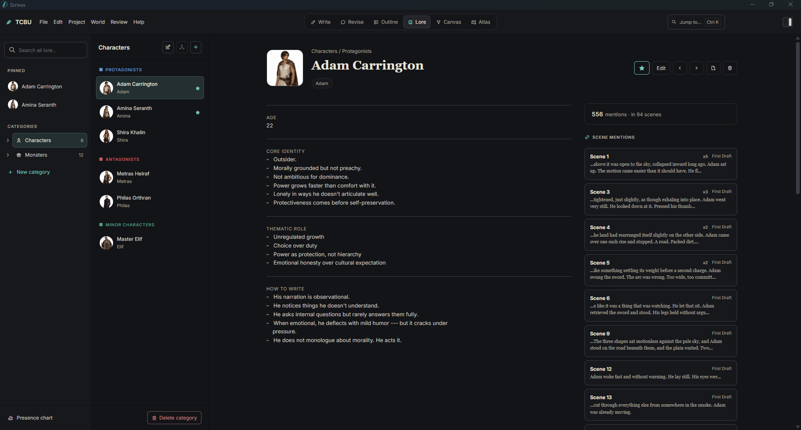

#### Lore Hierarchies

Use a category's hierarchy view to visualize organizations, family trees, or other nested groups. In the category editor, add subcategories, assign each one's **Child of** parent, and choose colors. Assign entries to those subcategories to place them in the hierarchy.

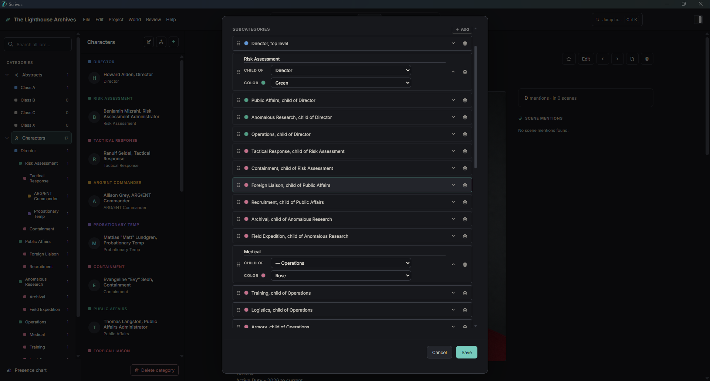

Once at least one subcategory has a parent, click the category's **Show hierarchy** button to see those relationships as a chart. Its display settings let you customize the arrangement of subcategory labels, entry images, and names.

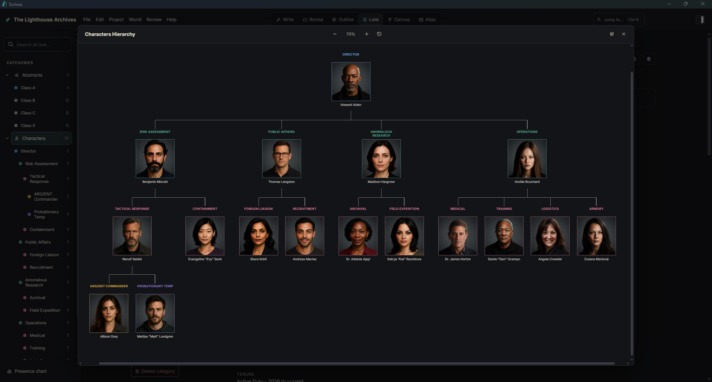

### Atlas

Atlas keeps maps inside the project. Import a map image, place markers, choose marker types, adjust labels, and control when markers appear at different zoom levels.

Atlas has a collapsible map binder, a searchable marker list, category visibility toggles, map settings, and interactive minimap and fit controls. Markers can link to existing Lore entries or create new ones. A selected place card shows its linked Lore entry and scene mentions, with shortcuts to the referenced scenes. Map deletion requires confirmation.

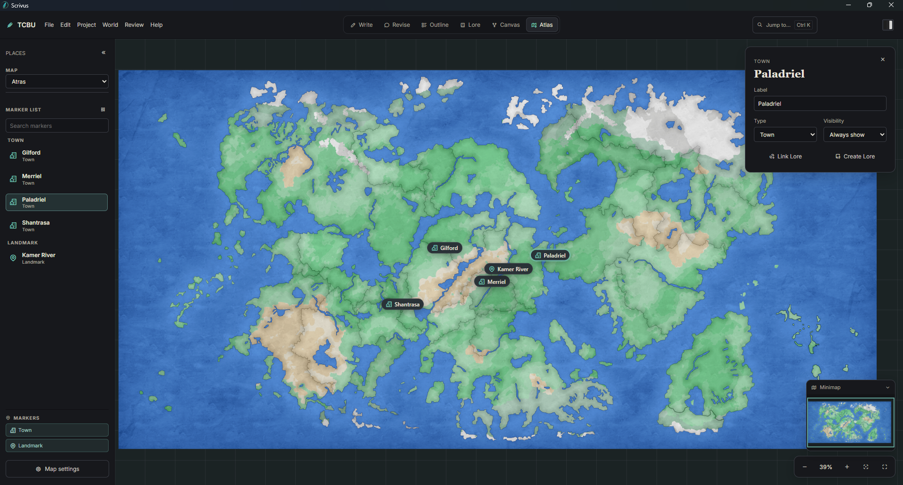

### Compile

Open **Project > Compile** to choose which acts, chapters, scenes, and draft tabs to export, include optional front matter, optionally include scene titles, and generate either a `.docx` manuscript or an `.epub` ebook. DOCX presets include Standard Manuscript, which uses the project's configured styles; Proof Copy, a monospaced, double-spaced proof layout; and Manuscript (Shunn), a submission-style layout with Times New Roman 12, a running header, centered scene breaks, and an END marker.

Compile selections are remembered per manuscript. Deselecting a parent act or chapter updates its child items. Exports use the active manuscript's book metadata and cover from Project Settings. EPUB exports include a table of contents and optional title page; DOCX style presets do not apply to EPUBs.

Compile reuses cached scene revisions and refreshes changed scenes, reducing repeated preparation work. A project backup completes before the Compile selection screen is ready.

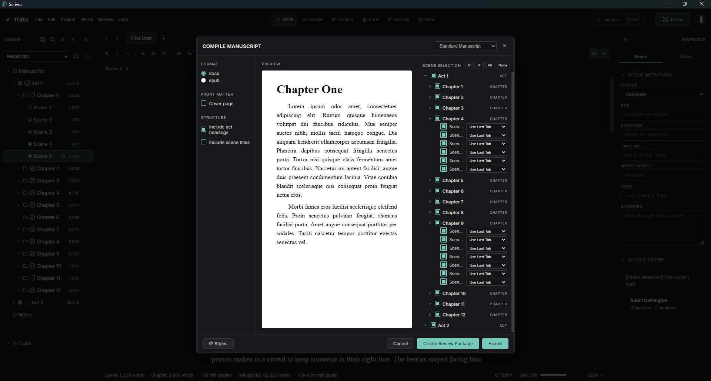

## Sharing

**Review packages:** Use **Create Review Package** in Compile to share selected scenes and drafts as a `.scrivusreview` file. A reviewer opens it through **File > Open Review Package**, adds feedback in the read-only Revise workspace, and exports a `.scrivuscomments` file through the Review menu. Import that file into the original project to bring the comments back.

**World packages:** The **World** menu exports selected Lore, Canvas, Atlas, and dictionary data as a `.scrivusworld` file. Import selected components into another project to reuse worldbuilding.

## Project Variables

Open **Edit > Project Settings > Variables** to define categorized numbers and expressions. Reference them in manuscript or Lore text with `{{Category:Variable}}`; editor autocomplete helps insert references. Variable definitions can reference other variables, so a shared value can drive several calculations.

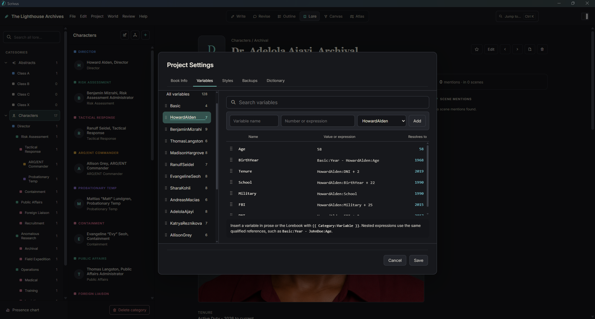

For example, keep a character's age consistent as the story's year changes:

1. Create a category named `Basic` and add `Year` with the value `2026`.
2. Create a category named `Mara` and add `BirthYear` with the value `1998`.
3. In `Mara`, add `Age` with the expression `Basic:Year - Mara:BirthYear`.
4. Save, then write this in a scene:

```text
It was {{Basic:Year}}, and Mara was {{Mara:Age}} years old.
```

Scrivus displays and exports: “It was 2026, and Mara was 28 years old.” Change `Basic:Year` to `2027`, and the calculated age becomes `29` wherever the reference is used.

Use `+`, `-`, `*`, `/`, and parentheses in expressions. In the Variables settings, enter a number or expression without braces; use double braces when inserting it into prose. Category and variable names must start with a letter or underscore and contain only letters, numbers, and underscores.

## Project Format and Backups

New projects are created as `.scrivus` project folders. A project contains `project.json`, scene files, Notes, Canvas, Atlas, Lore Book data, managed images, manuscript covers, compile selections, and writing stats.

Backups are stored separately in the app data directory by default, or in a custom location chosen in Project Settings. Backup settings include automatic backups and retention; the Project menu provides manual backup and restore actions. Backups cannot be stored inside the project folder.

Scrivus can also create a new project from a Word `.docx` manuscript. During import, headings such as `Act X`, `Chapter X`, and `Scene X` are converted into Scrivus folders and scenes. Supported Word formatting includes bold, italic, underline, bulleted lists, and numbered lists.

Scrivus records both the app version and a project format version. It creates a safety backup before opening a project, offers an upgrade flow for older formats, and blocks newer unsupported formats. Opening restores the last active scene and draft tab after loading the required project data. Read or JSON parse failures are reported instead of being silently treated as empty content; absent optional files receive defaults.

See [PROJECT_FORMAT.md](PROJECT_FORMAT.md) for more details.

## Privacy

Scrivus is local-first. Project content is stored on your machine, and the app does not require an account. The update checker contacts GitHub Releases when Scrivus starts and when you choose **Help > Check for Updates**.

See [PRIVACY.md](PRIVACY.md) for the full privacy note.

## Themes

Scrivus includes 20 built-in themes, with light and dark options for different writing environments. The set also includes high-contrast light and dark themes for visually impaired users who need stronger separation between text, panels, and controls.

In **Edit > Preferences**, adjust the gradient overlay's intensity with a live preview, enable optional gradient animation, or customize the read-only edge glow shared by Revise and split view. The gradient overlay is disabled in high-contrast themes.

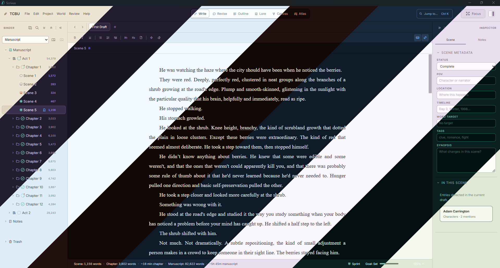
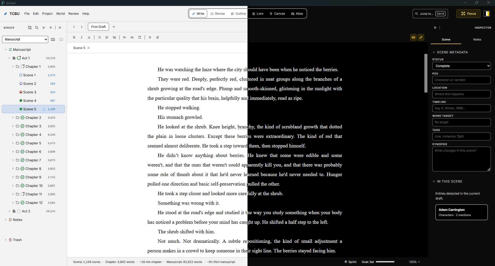

## Installing

Scrivus releases are distributed through GitHub Releases.

1. Download the latest installer from the [Scrivus releases page](https://github.com/ObsydianX/Scrivus/releases).
2. Run the installer.
3. Launch Scrivus and create or open a project.

## macOS

macOS builds are currently unsigned. If macOS reports that Scrivus is damaged, move Scrivus.app to Applications, then run:

```bash
xattr -dr com.apple.quarantine /Applications/Scrivus.app
open /Applications/Scrivus.app
```

## Development

Scrivus is built with Tauri, React, TypeScript, and Vite.

Development and release builds require Node.js 24.

Desktop development also requires Rust and the platform build tools used by Tauri. `npm run dev` starts the frontend; `npm run tauri dev` runs the desktop app with access to local project files.

```bash
npm install
npm run dev
```

To build the frontend:

```bash
npm run build
```

To run through Tauri:

```bash
npm run tauri dev
```

## License

Scrivus is released under the MIT License.

See [LICENSE.txt](LICENSE.txt).
